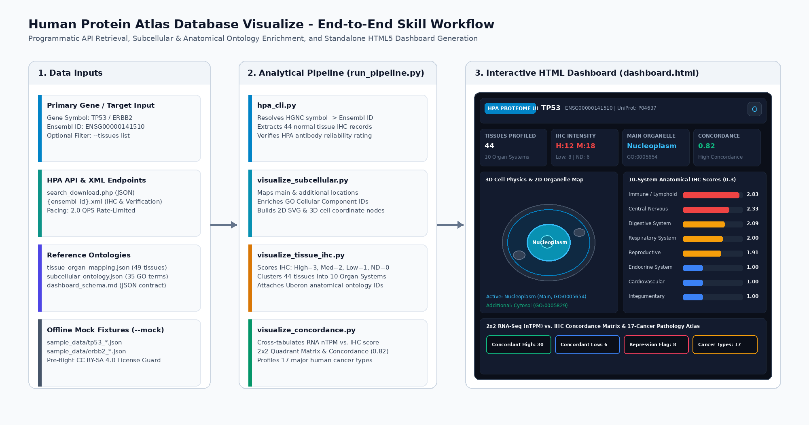

# Human Protein Atlas Database Visualize (`human-protein-atlas-database-visualize`)

## 1. Overview

`human-protein-atlas-database-visualize` is a scientific data retrieval, analysis, and visualization skill for profiling human proteins from the Human Protein Atlas (HPA).



### Core Capabilities
- **3D Physics & 2D Vector Subcellular Organelle Mapping**: Converts confocal immunofluorescence (ICC-IF) localization records into an interactive 2D vector eukaryotic cell schematic and a 3D volumetric cell/network physics simulation (`dashboard.html`) with main versus additional organelle highlighting and Gene Ontology (GO) Cellular Component identifiers.
- **10-System Anatomical IHC Expression Atlas**: Aggregates 44+ normal human tissues into 10 physiological organ systems (`Central Nervous System`, `Cardiovascular`, `Digestive`, `Endocrine`, `Immune / Lymphoid`, `Musculoskeletal`, `Reproductive`, `Respiratory`, `Urinary`, `Integumentary`) with standardized numerical staining scores (`0.0` to `3.0`) and Uberon ontology identifiers.
- **RNA vs. Protein Concordance Matrix & 2D Scatter Plot**: Cross-tabulates consensus RNA-seq transcript abundance (nTPM) against immunohistochemistry (IHC) protein staining to identify concordant expression, potential post-transcriptional repression, or enhanced protein stability alongside HPA antibody validation status (`Enhanced`, `Supported`, `Approved`, `Uncertain`).
- **Pathology & Cancer Proteome Profiling**: Summarizes tumor staining fractions and log-rank survival associations (`Favorable` vs. `Unfavorable` prognostic status) across 17 major human cancer types.
- **Interactive HTML5 Dashboard & Icon-Only Theme Toggle**: Generates a standalone `dashboard.html` file in the project root directory featuring an icon-only Light/Dark theme toggle button, an input-to-processed pipeline provenance banner, and live JSON dataset switching.
- **Deterministic Offline Mock Engine (`--mock`)**: Provides local curated fixtures (`TP53` and `ERBB2`) enabling reproducible offline verification and testing without external network requests.

---

## 2. Project Structure

All paths originate from the project root directory:

```text
.
├── LICENSE
├── README.md
├── SKILL.md
├── SKILL_LICENSES.md
├── dashboard.html
├── requirements.txt
├── .licenses/
│   └── human_protein_atlas_database_visualize_LICENSE.txt
├── assets/
│   ├── dashboard_schema.json
│   └── skill_workflow_overview.png
├── documents/
│   └── prd.md
├── references/
│   ├── citation.bib
│   ├── dashboard_schema.md
│   ├── search-api.md
│   ├── subcellular_ontology.json
│   └── tissue_organ_mapping.json
├── sample_data/
│   ├── erbb2_entry.json
│   ├── erbb2_subcellular.json
│   ├── erbb2_tissue_ihc.json
│   ├── tp53_entry.json
│   ├── tp53_subcellular.json
│   └── tp53_tissue_ihc.json
├── scripts/
│   ├── generate_dashboard.py
│   ├── hpa_cli.py
│   ├── run_pipeline.py
│   ├── visualize_concordance.py
│   ├── visualize_subcellular.py
│   └── visualize_tissue_ihc.py
├── skills/
│   └── human_protein_atlas_database_visualize/
│       ├── LICENSE
│       ├── SKILL.md
│       ├── assets/
│       ├── references/
│       ├── sample_data/
│       └── scripts/
└── tests/
    └── test_skill.py
```

---

## 3. License

This project is licensed under the **Apache License, Version 2.0**. The complete license text is located in [LICENSE](LICENSE) (and mirrored in [skills/human_protein_atlas_database_visualize/LICENSE](skills/human_protein_atlas_database_visualize/LICENSE)).

- **Software & Documentation License**: All Python scripts, HTML/CSS/JavaScript templates, JSON schemas, and Markdown documentation in this repository are distributed under the Apache License 2.0 ([LICENSE](LICENSE)).
- **Upstream Reference Data Attribution**: Data retrieved from the Human Protein Atlas (`https://www.proteinatlas.org/`) is governed by the Creative Commons Attribution-ShareAlike 4.0 International (CC BY-SA 4.0) license (`https://www.proteinatlas.org/about/licence`), registered in [SKILL_LICENSES.md](SKILL_LICENSES.md) and verified at runtime via `.licenses/human_protein_atlas_database_visualize_LICENSE.txt`.

---

## 4. Prerequisites

- **Operating System**: Linux, macOS, or Windows.
- **Python Version**: Python 3.10 or higher.
- **Dependencies**: Standard library modules (`urllib.request`, `xml.etree.ElementTree`, `json`, `pathlib`, `argparse`) are supported out of the box. Optional packages (`urllib3`, `pytest`) are listed in [requirements.txt](requirements.txt).

### Virtual Environment Setup
```bash
python3 -m venv .venv
source .venv/bin/activate
pip install -r requirements.txt
```

---

## 5. Local Execution

### 5.1 View the Pre-Built Project Dashboard Locally
A standalone interactive dashboard is located in the project root at [dashboard.html](dashboard.html). Open `./dashboard.html` in a local browser to inspect:
- The **icon-only Light / Dark theme toggle** in the top-right header.
- The **Input-to-Processed Pipeline Provenance Banner** and live dataset selector (`TP53`, `ERBB2`, or custom JSON file upload).
- The **Interactive 3D Physics Viewport** (`3D Cell Volume Physics` and `3D Organ Force Network`) alongside the **2D Vector Eukaryotic Cell Map** and **2D RNA-vs-Protein Concordance Scatter Plot**.

### 5.2 Run the Unified End-to-End Pipeline (Offline Mock Mode)
Execute the complete analytical and dashboard generation workflow deterministically without network calls:
```bash
python3 scripts/run_pipeline.py --gene TP53 --mock -o ./output/tp53_profile/
```
Or via the nested skill directory path:
```bash
python3 skills/human_protein_atlas_database_visualize/scripts/run_pipeline.py \
    --gene TP53 \
    --mock \
    -o ./output/hpa_visualize_test/
```

### 5.3 Run the Unified Pipeline (Live HPA API Mode)
Query `proteinatlas.org` at a rate-limited pace of 2.0 queries per second (QPS):
```bash
python3 scripts/run_pipeline.py --gene ERBB2 -o ./output/erbb2_live/
```

Filter for specific anatomical tissues:
```bash
python3 scripts/run_pipeline.py \
    --ensembl_id ENSG00000141736 \
    --tissues "cerebral cortex,liver,heart muscle" \
    --mock \
    -o ./output/erbb2_filtered/
```

### 5.4 Run Individual CLI Subcommands
```bash
# Resolve gene symbol to Ensembl ID
python3 scripts/hpa_cli.py resolve-ensembl-id TP53 --output ./output/tp53_id.json --mock

# Fetch normal tissue IHC staining levels
python3 scripts/hpa_cli.py get-tissue-expression ENSG00000141510 --output ./output/tp53_tissue.json --mock

# Fetch subcellular compartment localization
python3 scripts/hpa_cli.py get-subcellular-location ENSG00000141510 --output ./output/tp53_subcell.json --mock

# Fetch full multi-column HPA atlas entry
python3 scripts/hpa_cli.py get-atlas-entry ENSG00000141510 --output ./output/tp53_entry.json --mock

# Search HPA records by query criteria
python3 scripts/hpa_cli.py search-hpa --query "tissue_category_rna:Brain;Tissue enriched" --output ./output/search.json --mock
```

### 5.5 Run the Automated Test Suite
Execute all unit, smoke, and end-to-end system tests from the project root directory:
```bash
pytest tests/
```
Or run the test suite directly via Python:
```bash
python3 tests/test_skill.py
```

---

## 6. Non-Technical User Guide & Real-World Examples

Non-technical researchers, biologists, and students can use this skill through any compatible AI agent interface without writing code or running terminal commands.

### How It Works
1. **Load the Skill**: Point your agent interface to [SKILL.md](SKILL.md) (or [skills/human_protein_atlas_database_visualize/SKILL.md](skills/human_protein_atlas_database_visualize/SKILL.md)).
2. **Ask a Question in Plain English**: Name any human gene or protein (such as `TP53`, `ERBB2`, `EGFR`, or `BRCA1`) and ask where it is located inside the cell or how strongly it is expressed across human organs.
3. **Explore the Interactive Dashboard**: The agent runs the processing scripts in the background and opens [dashboard.html](dashboard.html) directly in your preview window. You can click compartments in the cell map, rotate the 3D organ network, toggle between Light and Dark themes using the top-right icon button, or download the filtered table as a CSV spreadsheet.

### Real-World Usage Examples

#### Example 1: Investigating a Tumor Suppressor Protein (`TP53`)
- **What You Ask the Agent**:
  > "Show me where the TP53 protein is located inside human cells and which organ systems have the highest TP53 protein levels. Also check whether its RNA levels match its protein levels."
- **What the Skill Does**:
  - Resolves `TP53` to Ensembl ID `ENSG00000141510` and retrieves immunohistochemistry records across 44 normal human tissues.
  - Maps its subcellular compartments (`Nucleoplasm` as main location `GO:0005654`, and `Cytosol` as additional location `GO:0005829`).
  - Groups the 44 tissues into 10 physiological organ systems and calculates a `0.82` (`High Concordance`) alignment between RNA transcript abundance and protein staining.
- **What You See in the Dashboard**:
  - **KPI Summary Cards**: Displays `44 Normal Tissues Profiled`, `High: 12 | Med: 18 | Low: 8`, `Nucleoplasm`, and `0.82 Concordance`.
  - **3D & 2D Cell Map**: Highlights the cell nucleus (`Nucleoplasm`) in cyan and the surrounding `Cytosol` so you can click each organelle to read its biological function.
  - **Anatomical Heatmap**: Ranks the highest-expressing systems (`Immune / Lymphoid` at `2.83 / 3.00`, `Central Nervous System` at `2.33 / 3.00`, and `Digestive` at `2.09 / 3.00`).

#### Example 2: Profiling a Drug Target Receptor (`ERBB2` / `HER2`)
- **What You Ask the Agent**:
  > "Profile the ERBB2 (HER2) receptor across digestive, urinary, and reproductive tissues, and show its prognostic significance across human cancer types."
- **What the Skill Does**:
  - Resolves `ERBB2` (`ENSG00000141736`, UniProt `P04626`) and identifies `Plasma membrane` (`GO:0005886`) and `Cell junctions` (`GO:0030054`) as its primary cellular compartments.
  - Computes organ-system IHC staining scores showing strong expression (`Score 3.0`) in epithelial tissues including `stomach`, `duodenum`, `colon`, `breast`, `placenta`, `kidney`, and `urinary bladder`.
  - Summarizes tumor staining fractions and log-rank survival associations across 17 human cancer types (`Unfavorable` prognostic biomarker in breast, cervical, endometrial, ovarian, pancreatic, stomach, and urothelial cancers).

#### Example 3: Comparing Specific Tissues for Lab Assay Planning
- **What You Ask the Agent**:
  > "Compare TP53 protein staining and RNA nTPM specifically across cerebral cortex, liver, and heart muscle, and let me download the table as a CSV file."
- **What the Skill Does**:
  - Filters the tissue analysis specifically to `cerebral cortex`, `liver`, and `heart muscle`.
  - Renders the filtered dashboard where you can click the **CSV** button in the header (or use the **Interactive Data Explorer** tab) to download the spreadsheet for downstream laboratory documentation.

---

## 7. Citations & Scientific Disclaimer

- **Tissue Proteome Map**: Uhlén, M. et al. *Tissue-based map of the human proteome.* Science 347, 1260419 (2015). doi:10.1126/science.1260419.
- **Subcellular Map**: Thul, P. J. et al. *A subcellular map of the human proteome.* Science 356, eaal3321 (2017). doi:10.1126/science.aal3321.
- **Scientific Disclaimer**: HPA expression levels, antibody staining, and subcellular localizations are experimental research data derived from cell lines and human tissue microarrays. They are intended for scientific research and must not be used as clinical diagnostic or medical guidance.
